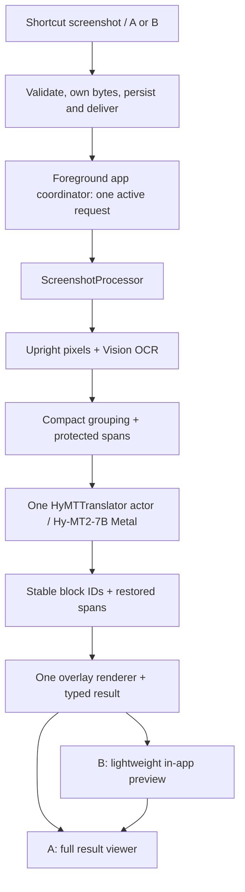

# Old app UX + ScreenTranslatorNext core: migration feasibility and deletion audit

Date: **2026-10-07**, Asia/Shanghai. Repository: `/Users/notnik_kg/Desktop/Programming/ScreenTranslator/ScreenTranslator`.

**Scope: planning only. No application behavior changed, legacy files deleted, build/device run, commit, or push performed for this audit.** The proposed implementation below has not started.

The audit follows the actual current working tree, including its existing uncommitted changes, at HEAD `19d01e24aadd45847b277c2626308927a4cc3638`. It traces the old App/Intents/Core/Features sources, native harnesses, project configuration, resources, server/tooling and tests, and reads all six Next source files, its manifest and runtime scripts. Historical reports are evidence for past device runs, not substitutes for inspecting current code. Source references below are to this working tree; line numbers can move during a later migration.

## 1. Feasibility verdict

**Migration feasible: YES WITH CHANGES.** Preserve the old input, routing and result experience; replace its translation infrastructure with the small Next processor. Both old UX routes already converge on one foreground application pipeline. There is no need to preserve Apple Translation, Quick Look translation providers, dictionaries, a Mac service, or old llama bridges to preserve either route.

**Floating screen: KEEP the existing in-app experience, with simplified internals.** The current `FloatingScreenTranslateIntent` opens ScreenTranslator into a lightweight preview route. It does not display a persistent window over another application. The separate `QuickLookTranslateScreenshotIntent` returns a PNG to Shortcuts and is not a dependency of the floating route.

**Recommended execution: foreground application.** A/B intents validate and own the screenshot bytes, persist/deliver the request and return. One application-owned task calls one processor and one actor-owned model. A foreground intent that awaits that same processor is a valid optional adapter for a completed-PNG contract; background inference is not the baseline for this 7B model.

The [authoritative fresh reboot report](/Users/notnik_kg/Desktop/Programming/ScreenTranslator/ScreenTranslator/docs/OCT_2026_FRESH_REBOOT_REPORT.md:3) records successful Next execution on a physical iPhone 17 Pro Max, iOS 26.5.1: 11 synthetic screenshot runs, 98 translated blocks, 43 protected spans, no final generation/EOG, placeholder, render-fit or intersection errors, and no memory warnings. Current code implements that same direct pipeline. This proves the new core can run on that device; it does **not** prove migration of the old intents/viewer or quality on arbitrary authentic screenshots.

The changes needed before adoption are small but material: expose a typed result and progress, connect reliable foreground handoff delivery, integrate the pinned native runtime/model into the original target, and complete cancellation/lifecycle handling. Do not route Next through the old provider/service graph.

## 2. Exact old UX flows

### A. TranslateScreenshotIntent: screenshot → app → full result

1. A Shortcut supplies its screenshot output to the `Screenshot` image `IntentFile` parameter, which is connected to the previous action's result.
2. [`TranslateScreenshotIntent.perform()`](/Users/notnik_kg/Desktop/Programming/ScreenTranslator/ScreenTranslator/Intents/TranslateScreenshotIntent.swift:18) calls the private `ShortcutIntentExecutor` in the same file with `.openInApp`. `openAppWhenRun = true` requests application opening. The intent returns `.result()` after persistence; it does not translate or return a translated image.
3. [`IntentInputDecoder`](/Users/notnik_kg/Desktop/Programming/ScreenTranslator/ScreenTranslator/Intents/IntentInputDecoder.swift:22) rejects empty/non-image input. Its owned Data copy at line 47 protects against Shortcuts/WorkflowKit's transient backing file. `ScreenshotInputBuilder` builds the input metadata.
4. [`TemporaryImageStore.store`](/Users/notnik_kg/Desktop/Programming/ScreenTranslator/ScreenTranslator/Core/Services/Storage/TemporaryImageStore.swift:32) atomically writes `IntentHandoffRequest` to `Application Support/ScreenTranslator/IntentHandoff/pending-screenshot.json`. The request includes screenshot identity/timestamp and launch behavior. It is a single latest pending request, with a 15-minute freshness window, not a queue. Consumption removes the pending file before processing.
5. [`ScreenTranslatorApp`](/Users/notnik_kg/Desktop/Programming/ScreenTranslator/ScreenTranslator/ScreenTranslatorApp.swift:32) drains pending input from `.task(id: scenePhase)` when the scene is active. [`AppEnvironment.consumePendingScreenshotIfNeeded`](/Users/notnik_kg/Desktop/Programming/ScreenTranslator/ScreenTranslator/App/AppEnvironment.swift:54) consumes it, asks `IntentResultRouter` for the route, creates a `ProcessingJob`, then calls `AppCoordinator.showProcessing` and `ProcessingViewModel.handleIncomingScreenshot`.
6. [`ProcessingViewModel`](/Users/notnik_kg/Desktop/Programming/ScreenTranslator/ScreenTranslator/Features/Processing/ProcessingViewModel.swift:97) awaits the old `ProcessingOrchestrator`: old normalization → Vision OCR → old grouping → Apple Translation → old overlay renderer. This is the internal call to replace.
7. The completion callback in [`AppEnvironment`](/Users/notnik_kg/Desktop/Programming/ScreenTranslator/ScreenTranslator/App/AppEnvironment.swift:28) calls `coordinator.showResult`. The root route selects `ResultOverlayView`: translated screenshot, original/translated viewing, zoom, block details, transcript, share and Photos save.

Keep this action identity, screenshot connection and direct processing/result route. It already avoids a required home-screen interaction. Keep retry and stale-run suppression; replace the orchestrator and translation setup.

### B. FloatingScreenTranslateIntent: screenshot → app → lightweight result

[`FloatingScreenTranslateIntent.perform()`](/Users/notnik_kg/Desktop/Programming/ScreenTranslator/ScreenTranslator/Intents/TranslateScreenshotIntent.swift:67) uses **the same executor, input decoder and persistent handoff**, but stores `.floatingPreview`. It also sets `openAppWhenRun = true`.

`AppEnvironment` selects `showFloatingPreview(job:)` and invokes the same `ProcessingViewModel`. On completion it calls `retainFloatingPreviewResult`, so the route remains the lightweight viewer instead of switching automatically to the full viewer. Errors stay in that route with retry.

[`FloatingPreviewFlowView`](/Users/notnik_kg/Desktop/Programming/ScreenTranslator/ScreenTranslator/Features/Processing/ProcessingView.swift:80) is an ordinary SwiftUI `NavigationStack`/`ScrollView` inside the application's `WindowGroup`. It displays the source while working and the rendered PNG once available, with progress, error/retry and an **Open Full Viewer** button at line 98. That button presents the existing result; it need not retranslate.

There is no `QLPreviewController`, PiP controller, special `UIWindow`, window level or cross-application overlay in this route. Preserve the lightweight result/progress screen and direct route. Remove obsolete translation/debug explanations such as the `Translation.framework` copy at line 295.

### C. QuickLookTranslateScreenshotIntent: separate legacy PNG-return path

[`QuickLookTranslateScreenshotIntent`](/Users/notnik_kg/Desktop/Programming/ScreenTranslator/ScreenTranslator/Intents/TranslateScreenshotIntent.swift:28) sets `openAppWhenRun = false`. Its `perform()` directly awaits `QuickLookIntentRunner.run(.translated)` and returns an `IntentFile` containing PNG data. It does not use the persistent handoff, `AppCoordinator`, `ProcessingViewModel`, or A/B result routes.

[`QuickLookIntentRunner`](/Users/notnik_kg/Desktop/Programming/ScreenTranslator/ScreenTranslator/Intents/QuickLook/QuickLookIntentRunner.swift:53) has its own **15-second application-defined timeout**, Vision OCR, OCR mapping/grouping, providers, diagnostic/fallback handling and renderer. This is not evidence of a universal iOS intent execution limit. A subsequent **Quick Look action in the Shortcut** previews its returned file; neither A nor B calls this runner.

The [setup guide](/Users/notnik_kg/Desktop/Programming/ScreenTranslator/ScreenTranslator/Features/Settings/ShortcutsSetupView.swift:17) teaches A/B. C is nevertheless [publicly registered](/Users/notnik_kg/Desktop/Programming/ScreenTranslator/ScreenTranslator/Intents/AppShortcutsProvider.swift:27). The audit did not inspect the user's installed Shortcuts, so it cannot declare C unused.

For the requested A/B final scope, retire C as a separate action after the transition. Keep its identity temporarily while existing shortcuts are accounted for. If PNG-return compatibility is required, replace only its entry-point implementation with a small **foreground, same-core** adapter; do not retain its translation stack. This changes its old background/no-app-opening behavior and needs explicit product acceptance plus a physical Shortcut test. It is optional and not required to preserve B.

### UX classification

| Component | Classification | Final treatment |
|---|---|---|
| A/B intent identities, image parameters, registrations | **KEEP** | Preserve the original bundle/action identities and two result destinations. |
| Input type/empty-data validation and owned copy | **KEEP** | This is a real input-lifetime boundary, independent of the translator. |
| `ScreenshotInputBuilder`, orientation metadata wrapper | **KEEP BUT SIMPLIFY** | Pass validated image bytes/UIImage; physically normalize once in Next. |
| Atomic persistent handoff, identity, freshness | **KEEP BUT SIMPLIFY** | One handoff owner, direct delivery signal plus activation fallback; no polling. |
| Raw legacy `ScreenshotInput` decoding in handoff | **DELETE** after transition | Keep only briefly if a pre-upgrade pending request must remain readable. |
| `IntentResultRouter` | **KEEP BUT SIMPLIFY** | Its two-case routing belongs in the coordinator; no router service is necessary. |
| `AppCoordinator`, foreground activation handling | **KEEP BUT SIMPLIFY** | One owner for launch destination, active job and result. |
| `AppEnvironment`, `AppContainer`, `AppServices` service graph | **REPLACE INTERNALS** | Direct construction of one engine/coordinator; remove the provider graph. |
| Processing/progress/retry/error UI and run-ID guard | **KEEP BUT SIMPLIFY** | Call the new processor and report real stages/errors. Native cancellation must accompany Swift cancellation. |
| `ProcessingOrchestrator` | **DELETE** | Call `ScreenshotProcessor.process` directly. |
| `FloatingPreviewFlowView` | **KEEP BUT SIMPLIFY** | Direct lightweight in-app result; remove debug/handoff implementation copy. |
| Full result, chrome gestures, zoom/pan, details, transcript, share/save | **KEEP** | Adapt these views to the new result contract. |
| Old viewer DTOs and hard-coded Russian translation labels | **REPLACE INTERNALS** | One result type and target-driven labels for EN/RU. |
| SwiftUI fallback overlay drawing in `OverlayCanvasView` | **DELETE** | Keep its useful viewing/hotspot/transcript portions; Next supplies the composed image. |
| `ShortcutsSetupView`, native `ShortcutsLink` | **KEEP BUT SIMPLIFY** | Preserve guided A/B setup; current plist has no configured import URLs. |
| Apple offline language preparation | **REPLACE INTERNALS** | Verified pinned-model readiness/import plus EN/RU selection. |
| Legacy render-style sliders / ineffective preferred-mode setting | **DELETE** unless actually wired | Keep the working original/translated toggle. Start with Next's fixed render style; do not preserve dead controls. |
| LAN preflight, remote-server settings, Stage 1 launch controls | **DELETE** | They do not belong to a single local translator. |
| C Quick Look translation action | **DELETE** for A/B-only final scope | Temporarily retain identity; optional replacement entry point uses the same foreground core. |

## 3. Exact new pipeline and required interface

The reusable implementation is **458 physical source lines**, not a large service architecture. Next's complete six-file experiment is 625 lines; the extra 167 lines are its UI and benchmark harness.

| Current implementation | Reuse | Necessary adaptation |
|---|---|---|
| [`ScreenshotProcessor.swift`](/Users/notnik_kg/Desktop/Programming/ScreenTranslator/ScreenTranslator/ScreenTranslatorNext/ScreenshotProcessor.swift:100), 200 LOC including actor/model helpers | Direct image → OCR → grouping → translation → rendering entry | Expose typed blocks/layout/failures and progress; remove benchmark-file writes from ordinary release processing. |
| Same file, lines 103–114 | One physical UIImage redraw and accurate Vision OCR | Accept the original decoded screenshot; skip the old normalizer. Both OCR and renderer must use these upright pixels. |
| [`TextBlocks.swift`](/Users/notnik_kg/Desktop/Programming/ScreenTranslator/ScreenTranslator/ScreenTranslatorNext/TextBlocks.swift:24), 87 LOC | Compact geometric row/paragraph grouping and Chinese filtering | Keep the simple heuristics. Resolve the name collision with old `Core/Models/TextBlock.swift` once, rather than adding parallel compatibility types. |
| Same file, [`ProtectedSpans`](/Users/notnik_kg/Desktop/Programming/ScreenTranslator/ScreenTranslator/ScreenTranslatorNext/TextBlocks.swift:55) | Mask/restore Latin identifiers, prices, units and dimensions; validate placeholders | Preserve rejection of malformed/corrupted spans. It protects OCR text, not OCR accuracy, and is not a semantic dictionary. |
| [`HyMTTranslator`](/Users/notnik_kg/Desktop/Programming/ScreenTranslator/ScreenTranslator/ScreenTranslatorNext/ScreenshotProcessor.swift:11) | One actor owns model verification/import, load, warmup and generation | Application-scoped lifetime, safe cancellation/unload and one active screenshot job. |
| [`HyMTNative.h`](/Users/notnik_kg/Desktop/Programming/ScreenTranslator/ScreenTranslator/ScreenTranslatorNext/HyMTNative.h:1) / [`HyMTNative.mm`](/Users/notnik_kg/Desktop/Programming/ScreenTranslator/ScreenTranslator/ScreenTranslatorNext/HyMTNative.mm:29), 171 LOC | One model/context, mmap, Metal, embedded model Jinja, sampling, EOG validation | Compile/link the pinned runtime into the original target; remove legacy bridge/runtime linkage. Complete cancellation around load/warmup. |
| Processor lines 129–150 | One generation per grouped block, output keyed by original integer ID | Preserve IDs; do not remap translations by completion order or regenerate IDs in the UI. |
| Processor lines 156–191 | One native composed overlay; measured text fitting and visible failure outlines | Expose the actual panel rectangles already recorded at line 187. Retain partial-failure information. |
| [`model.json`](/Users/notnik_kg/Desktop/Programming/ScreenTranslator/ScreenTranslator/ScreenTranslatorNext/model.json:1) | One pinned model/runtime manifest | Bundle it with the original target and use that app's model location. No backend/model selector is required. |
| [`tools/runtime/build.sh`](/Users/notnik_kg/Desktop/Programming/ScreenTranslator/ScreenTranslator/tools/runtime/build.sh:1), fetch/install/check scripts | Reproducible current runtime and development tooling | Update hard-coded Next paths/bundle/project. Verify cached artifact provenance before reuse; do not add a second production runtime. |

Selected artifact: **Hy-MT2-7B-Q4_K_M**, `tencent/Hy-MT2-7B-GGUF`, revision `ab8472660ac61fac25f1af43fac2599d52a8a775`, **4,624,648,896 bytes** (~4.62 GB / 4.31 GiB), SHA256 `9f96256500f3fc1ab4d64336b58f52a949a95ad7516b0c229476eef782f9f77b`. Runtime: **llama.cpp v0.6.0 / b11429**, commit `d81235049384534c167caea52b85a694f6103d14`. Preserve the current embedded 7B chat template, target instruction, sampling and validation; migration is not a prompt/model experiment.

### The one UI-facing result

Current `ProcessedScreenshot` returns original/rendered `UIImage` plus `[String: Any]` diagnostic report. That is adequate for the experiment but insufficient as the permanent rich-viewer contract. Extend/replace it directly with one typed result containing:

- Request identity, target language, upright original image and rendered image. Encode PNG on export/handoff rather than storing several redundant full-image copies.
- Ordered blocks: stable result-local ID, original text, optional translated text, source pixel rectangle, optional **actual rendered rectangle**, and translation/render failure.
- A small status/warnings summary; detailed timings/runtime JSON can remain a debug export.

Use either result-local integer IDs with viewer selection reset on a new request, or `(request UUID, block ID)`. Old blocks use UUIDs and Next uses integers; that is a simple UI-model change, not a reason to resurrect `TranslationBlock`/`OverlayRenderResult` adapter chains.

One processing call is enough: `ScreenshotProcessor.process(image, to: target, engine: appEngine, onProgress: ...) async throws -> ProcessedScreenshot`. A small progress callback can report verification/loading/OCR/grouping/translated-count/rendering. One tiny stage value and one result type suffice; no `TranslationServiceProtocol`, factory, provider enum, service locator or generalized configuration object is needed.

Important viewer adaptations:

- [`OverlayCanvasView`](/Users/notnik_kg/Desktop/Programming/ScreenTranslator/ScreenTranslator/Features/ResultOverlay/OverlayCanvasView.swift:187) uses rendered geometry for translated hotspots and source geometry for originals. Next panels can expand, so substituting source boxes would misalign taps/highlights.
- Keep [`ZoomablePreviewImage`](/Users/notnik_kg/Desktop/Programming/ScreenTranslator/ScreenTranslator/Features/ResultOverlay/ZoomablePreviewImage.swift:311) zoom, pan, double-tap and accessible hotspot behavior. It is useful UI, not a duplicate image renderer.
- Remove the second positioned SwiftUI renderer at [`OverlayCanvasView.swift:95`](/Users/notnik_kg/Desktop/Programming/ScreenTranslator/ScreenTranslator/Features/ResultOverlay/OverlayCanvasView.swift:95) and its fallback transform at line 234. Retain transcript/UI uses of `OverlayBlockView`.
- Remove source-as-translated export fallbacks in [`ResultOverlayView.swift:336`](/Users/notnik_kg/Desktop/Programming/ScreenTranslator/ScreenTranslator/Features/ResultOverlay/ResultOverlayView.swift:336) and line 347. A partial result or failure must be described accurately.
- Replace Russian-only labels/progress with result-target labels. Keep the [Photos usage description](/Users/notnik_kg/Desktop/Programming/ScreenTranslator/ScreenTranslator/SupportingFiles/Info.plist:30), `UIActivityViewController` sharing and Photos save behavior.

## 4. Keep/delete/replace map for translation infrastructure

The classifications below describe the **migration destination**, not permission to delete today. `DELETE` components remain untouched in this audit. During phases 1–2, old sources may remain for comparison/build transition, but they must not become automatic runtime fallbacks after a route is switched to Next.

| Component / exact location | Classification | Reason / replacement |
|---|---|---|
| `Core/Services/Translation/OnDeviceTranslationService.swift`, including `TranslationSessionBroker` | **DELETE** | Broker continuations, session timeouts and Apple Translation ownership disappear. Direct `HyMTTranslator` replaces them. |
| `TranslationLanguageManager.swift`, `TranslationBatchBuilder.swift`, `TranslationService.swift`, `Core/Protocols/TranslationServiceProtocol.swift` | **DELETE** | Apple language readiness, batch response mapping/order fallback and failure mapper are not needed by the ID-mapped Next path. |
| `TranslationSessionHostView` / `.translationTask` in `ScreenTranslatorApp.swift` | **DELETE** | Invisible SwiftUI session host exists for Apple Translation. |
| `Features/Settings/LanguagePreparationView.swift` and corresponding settings preparation methods | **DELETE** | Replace with pinned GGUF import/readiness, without Apple language downloads. |
| `App/AppServices.swift`, `App/AppContainer.swift`, old `ProcessingOrchestrator` | **DELETE** as infrastructure | Construct one engine and call one processor; preserve their useful UI ownership behavior in the coordinator. |
| `Intents/QuickLook/QuickLookLocalMTConfig.swift` | **DELETE** | Remove `QuickLookMTBackendMode` (`remoteHyMT`, `disabled`, `onDeviceExperimental`), server URLs, timeouts, toggles and selection flags. |
| `QuickLookLocalMTClient.swift`, `QuickLookLocalMTTranslationProvider.swift`, `QuickLookMTBackend` and implementations | **DELETE** | Remove HTTP transport, provider dispatch, experimental backend branching, retries and per-domain routing. |
| `QuickLookMTBlockPreparer.swift` | **DELETE** | Domain/category preparation and special routes are replaced by the small `groupText` + `ProtectedSpans` path. |
| `QuickLookEnglishTranslationProvider.swift`, `QuickLookLocalDictionaryTranslationProvider.swift`, `QuickLookCEDICTStore.swift`, `QuickLookCJKTextDetector.swift` | **DELETE** | Domain phrases, dictionary assembly/CEDICT lookup and old CJK cleanup are not a second translator in the final app. Next's Chinese filter/span validation remain. |
| `Resources/Dictionaries/QuickLookCEDICTGeneral_v2.sqlite`; `tools/dictionaries/` and its fixtures | **DELETE** from final translator/repo tooling | No final runtime caller needs the dictionary. Keep historical measured outputs in docs if useful. |
| `QuickLookOCRBlockMapper.swift`, `QuickLookTextBlockGrouper.swift` | **DELETE** | Duplicate OCR mapping/geometric grouping; Next is the sole implementation. |
| `QuickLookOverlayRenderer.swift` | **DELETE** | Duplicate image renderer; Next composes the final image. |
| `QuickLookDiagnosticsModels.swift`, `QuickLookDiagnosticsRenderer.swift` | **DELETE** | Diagnostics model obsolete providers/routes/fallback outcomes. Retain only small current-core timing/error exports. |
| `QuickLookIntentRunner.swift`, `QuickLookIntentFileFactory.swift`, fallback PNG renderer embedded in runner | **DELETE** | C is independent of A/B. Optional PNG compatibility needs only encoding and the same foreground processor, not this runner. |
| `QuickLookDebugOCRIntent`, `QuickLookEchoScreenshotIntent`, `QuickLookDirectEchoScreenshotIntent`, `QuickLookTinyPNGIntent` and public registrations | **DELETE** from release app | Probe success/tiny PNG assumptions do not validate 7B execution. Current registrations are not DEBUG guarded. A small current-core harness covers actual debugging. |
| `Core/Services/OnDeviceMT/OnDeviceLlamaNativeRuntime.swift`, `OnDeviceLlamaSmokeTestService.swift`, `Native/OnDeviceLlamaBridge.h/.mm` | **DELETE** | Old local llama harness and prompt-profile architecture; replace with the 171-line new bridge and actor. |
| `Native/Stage1HyMTBridge.h/.mm`, `Features/OnDeviceMT/Stage1HyMTBenchmark.swift`, old on-device debug view/view model | **DELETE** | Old Stage 1 and smoke-test implementations must not become production backends. |
| `OnDeviceLlamaPromptProfile`, category-specific retry prompts, output cleanup/CJK repair/rescue logic in old harness/providers | **DELETE** | Preserve current model's official instruction/template/EOG and span rejection. No semantic repair/fallback chain. |
| `Core/Services/OCR/`, `Core/Services/Grouping/`, `Core/Services/Rendering/` and their one-implementation protocols | **DELETE** after caller adaptation | Replaced by the compact processor/grouping/renderer. Do not retain them to satisfy legacy service interfaces. |
| `ScreenshotNormalizer.swift`, old orientation relabeling helpers | **DELETE** after input adaptation | One physical redraw in Next avoids duplicate/inconsistent image normalization. Keep image validation. |
| Fallback result in `ProcessingOrchestrator.swift:77`, ordered batch fallback, dictionary/remote/retry provider fallbacks | **DELETE** | A render/translation failure must remain visible rather than be reported as successful translation. |
| `Core/Services/Storage/HistoryStore.swift`, `HistoryStoreProtocol`, unused `historyEnabled` setting | **DELETE** | No useful persistent-history runtime consumer was found; do not build a new repository for it. |
| Legacy debug inspector DTOs/views in `Features/Debug/` | **DELETE** where tied to old pipeline | Keep useful current image/block diagnostics only if they read the same new result. Whole-directory deletion is not required to preserve viewer UI. |
| `tools/opus_mt_server/`: FastAPI server, client CLI, registry, `hymt_engine.py`, `opus_mt_engine.py`, conversion/download scripts | **DELETE** from final application/tooling dependency | Mac/LAN backend unnecessary. Current registry supports HyMT only; OPUS code is dormant/refused, not an active automatic OPUS fallback. |
| Old Hy-MT1.5/OPUS model/config dependencies; `LocalLlama/`, `Config/OnDeviceLlamaBridge.xcconfig`, old bridging-header imports, Stage 1 embedding phase | **DELETE** from final target | Exactly one v0.6.0 runtime and one selected GGUF. Remove project references/linker/embed settings together with callers. |
| Local owner model files / ignored downloaded build artifacts | **KEEP TEMPORARILY DURING MIGRATION** | Removing an app dependency is not authorization to erase the owner's cached models/artifacts. Any later disk cleanup is separate. |
| C action identity and legacy pending-request decode | **KEEP TEMPORARILY DURING MIGRATION** | Public Shortcut compatibility / pre-upgrade pending input; remove after explicit transition handling. |
| `ScreenTranslatorNextApp.swift` experimental UI/project | **KEEP TEMPORARILY DURING MIGRATION** | Use as a known-good comparison. Later retire it or keep a thin development target referencing the exact same core files. |
| `ScreenTranslatorNext/DeviceBenchmark.swift`, `tools/runtime/checks.swift`, card/quality tools | **KEEP AS DEBUG TOOL** | Exercise the current processor/model, without a separate translator or release auto-run hooks. |
| Three historical `stage1a_*` / `stage1b_*` study scripts | **KEEP AS DEBUG TOOL**, outside app | Optional reproducibility evidence only, not compiled/used by release. They may be archived later; their LOC is not assumed removed below. |
| Historical reports, benchmark JSON and retained comparison outputs | **KEEP AS DEBUG TOOL / evidence** | Preserve measured provenance; they do not add production translation backends. |
| `ScreenshotProcessor`, `TextBlocks`, `ProtectedSpans`, `HyMTTranslator`, `HyMTNative`, pinned model manifest/runtime | **KEEP IN FINAL APP** | One shared translation pipeline. |
| Owned screenshot input, minimal handoff/coordinator, old useful result UX | **KEEP IN FINAL APP** | The application shell and presentation are the reusable product behavior. |

### Ranked cuts, with caller consequences

These recommendations were checked against current source callers, project references, tests and fixtures; they are not instructions to remove isolated files before their consumers are adapted.

1. **Remove the whole independent Quick Look translation stack** (`Intents/QuickLook/`, 11,835 LOC): A/B do not call it; retire/replace C and public probes before removing its build references.
2. **Remove both old local native harnesses and their UI** (7,313 LOC): settings/debug and `QuickLookMTBackend` currently reference them; link the new runtime/bridge and remove the old embedding phase first.
3. **Remove duplicate foreground OCR/grouping/rendering** (2,514 LOC): change `ProcessingViewModel` and result consumers to Next; update old geometry/orchestrator tests instead of keeping services solely for tests.
4. **Remove Apple Translation plus its host/language UI** (553 core LOC plus UI): change the direct foreground processing call before removing broker dependencies and `.translationTask`.
5. **Remove service-locator wiring and the old orchestrator** (404 LOC): keep job/routing behavior in one app coordinator; no replacement DI graph.
6. **Remove dictionary and server dependencies** (separate tooling/resources): remove provider/diagnostic consumers, LAN preflight and obsolete network plist entries; preserve Photos save permission.
7. **Remove viewer fallback rendering and dead controls**, retaining zoom, hotspots, transcript, real share/save and original viewing.

Relevant old tests include `TranslationBatchBuilderTests`, `ProcessingOrchestratorTests`, `BoundingBoxGrouperTests`, `TextGroupingServiceTests`, `TextBlockComposerTests`, `OverlayTextFitterTests` and `ScreenshotNormalizerTests`. They validate implementations being retired; do not reintroduce legacy code to keep them green. Retain/adapt input/handoff behavior tests and add bounded checks for the new result/ID/cancellation contract. The placeholder integration route helper is not an application requirement.

## 5. Floating-screen technical analysis

| Question | Current code answer | Recommendation |
|---|---|---|
| Does B use Quick Look? | No. It shares A's handoff and foreground processing. | Keep B without Quick Look translation infrastructure. |
| Does B open the main app? | Yes, `openAppWhenRun = true`; the app's root route chooses its lightweight view. | Open straight into progress/preview, with no required home/settings navigation. |
| How is the screenshot transferred? | Owned `IntentFile` bytes inside an atomically persisted same-app request. | Retain validated owned bytes and minimal persistence/delivery. |
| How is the translated image shown? | Existing rendered image in `FloatingPreviewFlowView`; optional full viewer uses the same result. | Substitute Next's composed image and typed result. |
| Which system APIs are used? | App Intents, ordinary SwiftUI app/window/navigation/image views and Foundation storage. | Preserve standard presentation; update deprecated intent execution declaration. |
| Is it reliable on iOS 26.5.1? | APIs remain usable, but this audit did not run the old A/B shortcuts on the device. The activation-only handoff has a timing risk. | Validate foreground delivery and model lifecycle on the actual device before claiming acceptance. |
| Is it a cross-app floating overlay? | No mechanism for one exists in this code. | Do not describe the retained B experience as staying above other apps. |

`openAppWhenRun` is deprecated starting in iOS 26, not removed. The current replacement is `supportedModes = [.foreground]` (equivalent to immediate foreground). If older deployment support remains, apply appropriate availability handling rather than using new APIs unguarded. [Apple runtime configuration](https://developer.apple.com/documentation/appintents/configuring-the-runtime-behavior-of-your-app-intents), [supportedModes](https://developer.apple.com/documentation/appintents/appintent/supportedmodes), [openAppWhenRun](https://developer.apple.com/documentation/appintents/appintent/openappwhenrun)

The closest modern equivalent to the **actual** old B is its current minimal in-app preview, or a minimal in-app sheet/full-screen result using the same image. No PiP video workaround, arbitrary cross-app window or translation extension is necessary. If the separate system preview is desired, a foreground awaited-PNG action followed by Shortcuts Quick Look can show the completed image. It is a different presentation contract and is not a guarantee of a persistent floating overlay. [Apple Quick Look image previews](https://developer.apple.com/documentation/quicklook/qlpreviewcontroller), [Shortcuts Quick Look](https://support.apple.com/en-lamr/guide/shortcuts/apda75604f37/ios)

**Handoff change required:** the current `.active` scene task can drain before the foreground intent finishes writing its request. There is also no new scene activation when already-active delivery needs processing. This is a static timing inference, not a reproduced device failure. After atomic persistence, signal the app coordinator to drain the single handoff (a simple in-process notification suffices); retain activation drain as recovery. Serialize store/claim through one handoff owner and claim each request ID once. A/B currently create separate store instances, so merely retaining each actor independently does not serialize their shared-file access. Keep an explicit latest-request policy and one active job; avoid a queue framework, file polling or a service bus.

## 6. AppIntent execution versus the 7B model

### Recommendation: B — foreground app task after handoff

For A/B, `perform()` should do only input validation, owned copy, persistence and delivery. Foreground activation must occur before the application task loads/uses the GPU model. The application task owns progress, cancellation, retry and the result route after the thin intent returns.

The old project has an app and test targets, **no App Intents extension target**. These are app-bundle intents; background execution is not automatically extension execution. Keeping everything in the original app avoids unnecessary IPC, App Group storage, model copies and an extension process. [Apple runtime execution behavior](https://developer.apple.com/documentation/appintents/configuring-the-runtime-behavior-of-your-app-intents)

Measured Next performance is incompatible with assuming a short background action:

| Device evidence from the fresh reboot report | Implication |
|---|---|
| SHA verification ~3 s, first successful model/context load 5.832 s, warmup 0.854 s; later cached load 0.270 s | Cold startup is substantial and variable. Keep it visible/cancellable; do not promise all launches are warm. |
| Preloaded full screenshots: EN **6.64–22.58 s**, RU **12.41–51.88 s** | The old runner's 15-second guard is already too short for several warm cases. Remove that runner, not model validation. |
| Resident endpoints ~4,921–4,941 MiB; footprint ~427–439 MiB | Footprint alone is not total model memory. Successful device runs do not establish unrestricted background memory allowance. |
| Repeated RU card 16.88/17.08/17.35 s; thermal state reached serious | Foreground progress and thermal/performance work remain relevant to UX. This is not instant translation. |

These are prior **Next** device measurements, not new migrated-app benchmarks. [Device results and limitations](/Users/notnik_kg/Desktop/Programming/ScreenTranslator/ScreenTranslator/docs/OCT_2026_FRESH_REBOOT_REPORT.md:82)

### A — inference awaited inside perform(): conditional, not the default

A foreground-only `perform()` may await the **same app-owned processor/actor** to return a completed PNG. That is useful only if C's returned-file contract must be retained. It does not require a provider abstraction or another model instance. It needs separate real-Shortcut validation of cold loading, long inference, cancellation and final Quick Look presentation; no universal safe AppIntent duration was established in this audit.

For iOS 26, `.foreground(.deferred)` starts in background and normally brings the app forward when `perform()` finishes. That is too late if inference occurs first. `.foreground(.dynamic)` may remain background. If either is deliberately used, check foreground-continuation capability and await `continueInForeground()` **before model loading**. Continuation can be unavailable or require confirmation; `alwaysConfirm = false` is not a guarantee of silent activation. Immediate foreground is the simpler A/B choice. `ForegroundContinuableIntent` / `requestToContinueInForeground` are deprecated in iOS 26. [Foreground modes](https://developer.apple.com/documentation/appintents/intentmodes/foreground), [deferred mode](https://developer.apple.com/documentation/appintents/intentmodes/foregroundmode/deferred), [continueInForeground](https://developer.apple.com/documentation/appintents/appintent/continueinforeground(_:alwaysconfirm:))

`CancellableIntent` is available from iOS 26.4. **`LongRunningIntent` and `allowedExecutionTargets` are iOS 27 APIs**, so they cannot solve execution on iOS 26.5.1. This availability was checked against Apple's documentation and the installed SDK declarations; do not import newer execution promises into this deployment. [CancellableIntent](https://developer.apple.com/documentation/appintents/cancellableintent), [LongRunningIntent](https://developer.apple.com/documentation/appintents/longrunningintent), [allowedExecutionTargets](https://developer.apple.com/documentation/appintents/appintent/allowedexecutiontargets)

### C — current continued-background mechanism: possible later, unnecessary now

Ordinary Metal work must stop submitting new GPU commands after entering background. The current app has no continued-processing registration or background GPU entitlement. Foreground processing with cancellation is the practical baseline. [Apple Metal background guidance](https://developer.apple.com/documentation/metal/preparing-your-metal-app-to-run-in-the-background)

iOS 26 also offers `BGContinuedProcessingTask` for foreground user-initiated work that continues after backgrounding, including GPU work when the requested `.gpu` resource, Background GPU Access entitlement and device support are present. Resource availability, cancellation and progress requirements still apply. This is an explicit exception, not something old intent flags enable. Do not add it to the shortest migration; reconsider only if sustained background completion becomes an accepted product requirement. [Apple continued processing](https://developer.apple.com/documentation/backgroundtasks/performing-long-running-tasks-on-ios-and-ipados), [GPU entitlement](https://developer.apple.com/documentation/bundleresources/entitlements/com.apple.developer.background-tasks.continued-processing.gpu)

## 7. Model lifecycle recommendation

**One model, one native context, one actor, one processor, one active screenshot job.** Create the engine once at the application root/coordinator, not in `perform()`, a view body, a result view model or each retry. The actor already serializes its synchronous native calls; the coordinator must additionally prevent multiple screenshot tasks from interleaving their block loops.

1. Import the pinned GGUF through the existing verified-copy path. The original app must have its own valid model file. `AlenShamatov.ScreenTranslatorNext` and `AlenShamatov.ScreenTranslator` have different sandboxes; the latter cannot read the former's Documents as an implicit model handoff.
2. Lazy-load and warm once for the first active request. Keep it loaded across processing/result/preview/settings navigation while the application remains active. Do not preload a 4.62 GB model merely to show setup UI.
3. On new input/retry, cancel the superseded Swift task **and** request native cancellation, wait for that job to leave native work, then begin the next job. Retain request/run-ID checks so late results cannot replace a newer result. Keep the source request available for retry.
4. On inactive/background transition, request cancellation and stop new GPU submission. After the current native call returns safely, unload in the actor on background/resource pressure. Never free the model/context concurrently with decoding. Foreground resume may reload on the next request; a result image remains viewable without the model.
5. On memory warnings, release inference and avoid retaining duplicate PNG/Data/UIImage copies. Model import/replacement also waits for native work before unload. Do not introduce timers, an engine pool or a background manager for this baseline.

The Next lifecycle is a starting point, not already finished integration. [`prepare()`](/Users/notnik_kg/Desktop/Programming/ScreenTranslator/ScreenTranslator/ScreenTranslatorNext/ScreenshotProcessor.swift:16) does not check task cancellation between native load and warmup, `load` has no cancellation callback, and [`generate()`](/Users/notnik_kg/Desktop/Programming/ScreenTranslator/ScreenTranslator/ScreenTranslatorNext/HyMTNative.mm:77) resets its cancellation flag on entry. A cancellation during load can therefore be lost before warmup. Add request-boundary checks around load/warmup and preserve cancellation across the request's block calls; use the runtime load progress/cancellation hook if supported safely. Cancellation is cooperative at native boundaries and cannot promise to interrupt an already-submitted Metal command immediately. This belongs in phase 1, without redesigning the engine.

## 8. Code reduction estimate

Counts are physical source lines **including blanks/comments** in current first-party files, not logical statements. They exclude tests, generated dependencies, downloaded llama sources, binaries, docs and asset catalogs. The old-app count covers `App`, `Intents`, `Core`, `Features` and root `ScreenTranslatorApp.swift`; Next is counted separately.

| Baseline | Files / LOC |
|---|---:|
| Old application Swift | **92 files / 28,418 LOC** |
| Old native bridge headers/ObjC++ | **1,839 LOC** |
| Old application source total | **30,257 LOC** |
| Next's reusable processor/grouping/actor/native core | **458 LOC** |
| Next complete experiment, including UI/benchmark | **625 LOC** |

### Non-overlapping old application removal/replacement inventory

| Bucket | Included source | LOC |
|---|---|---:|
| Apple translation | Four `Core/Services/Translation` files + `TranslationServiceProtocol` | **553** |
| Quick Look translation/config/dictionaries | CEDICT store, CJK detector, English/dictionary/MT providers, client/config, MT block preparer | **5,940** |
| Quick Look OCR mapping/grouping | OCR block mapper + text block grouper | **1,641** |
| Quick Look overlay renderer | `QuickLookOverlayRenderer` | **1,940** |
| Quick Look diagnostics | Models + renderer | **1,652** |
| Quick Look runner/file factory | Intent runner + IntentFile factory | **662** |
| Old local llama harness and debug UI | First bridge/header, native runtime, smoke service, debug view/view model | **5,561** |
| Old Stage 1 harness | Stage 1 bridge/header + benchmark Swift | **1,752** |
| Foreground duplicate OCR/grouping/rendering | Those service folders + three corresponding protocols | **2,514** |
| Old DI/orchestration | `AppServices`, `AppContainer`, `ProcessingOrchestrator` | **404** |
| **Total identified old app source eligible for removal/replacement** | | **22,619** |

The five Quick Look rows total **11,835 LOC**, exactly the 15-file `Intents/QuickLook/` folder. Its translation/config/dictionary subset is **5,940 LOC**; the dictionary-only subset is **2,400 LOC** (332 CEDICT + 1,138 English provider + 930 dictionary provider). These are subsets, **not additional lines to add**. Translation-focused old Swift alone is approximately **11,967 LOC** when counting Apple translation, Quick Look translation and the old native harnesses' Swift portions; broader removal includes duplicate geometry, diagnostics and wiring.

Viewer UI is deliberately not counted as wholly disposable: `Features/ResultOverlay` is **2,178 LOC**, including useful zoom/details/share/transcript code. Additional partial cuts include ~114 lines of the SwiftUI fallback renderer/transform, obsolete DTO/debug UI, Apple preparation settings, remote controls, orientation wrappers and public probe intents. Their exact net deletion depends on how much useful UI is retained.

### Separate tooling/resources, not added to application LOC

| Item | Measured size | Destination |
|---|---:|---|
| `tools/opus_mt_server` first-party Python/shell | **824 LOC** | Remove final dependency/tooling. |
| `tools/dictionaries` four Python scripts | **2,985 LOC** | Remove with CEDICT/providers. |
| `tools/on_device_llama` first-party scripts/C++/headers | **1,348 LOC** | Remove obsolete build/install/Jinja harness; optionally retain the 920 LOC historical study scripts as offline debug research. |
| Combined old tooling | **5,157 LOC** | **4,237 LOC** straightforward removal if the 920 LOC studies are retained; all 5,157 can disappear if those studies are archived too. |
| Bundled CEDICT SQLite | **3,514,368 bytes**, 12,320 rows | 12,277 `cc_cedict` + 43 phrase overrides; no final app dependency. |
| Old local Hy-MT1.5 / OPUS weights | Approximately **1.676 GB** plus metadata on disk | Remove target/tool references; do not automatically purge owner caches. |

The old weights are two Hy-MT1.5 files (461,861,216 and 1,133,080,512 bytes) plus OPUS `model.bin` (79,567,635 bytes), vocabulary/config. Actual local file size and Git's LFS-pointer representation are distinct. These are not the final selected 7B artifact.

### Expected final complexity

Conservative source arithmetic: **30,257 − 22,619 + 458 = 8,096 LOC** before adding small handoff/result/lifecycle adaptations and removing additional dead UI/DTOs. Net identified reduction is approximately **22,161 source lines (~73%)** before adaptation additions. A reasonable final source estimate is **6–8.5k LOC** with the rich old viewer retained, not a claim that the whole app can become 625 lines. These are planning estimates, not measured post-migration results.

Production dependencies also shrink: no Apple Translation session integration, CEDICT SQLite translator, FastAPI/LAN service or second llama bridge/runtime. Vision/UIKit/SwiftUI/App Intents and the pinned llama/Metal/Jinja core remain. The 4.62 GB selected model increases artifact size while the application architecture becomes smaller.

## 9. Smallest final architecture

Derive the final layout from useful existing files; do not split every compact processor stage into a service. Keep A/B in their current shared intent file if that remains simplest.

```text
ScreenTranslatorApp.swift               app scene, one coordinator/engine
App/
    AppCoordinator.swift                route, request/task/result ownership
    AppRoute.swift                      only real destinations, if still useful
Intents/
    TranslateScreenshotIntent.swift     existing A + B; thin handoff only
    IntentInputDecoder.swift            validation + owned image data
    AppShortcutsProvider.swift          final A/B registration
Core/
    ScreenshotHandoff.swift              adapted minimal store + request
    ScreenshotProcessor.swift            normalize, Vision, actor, mapping, render;
                                        typed result/progress beside it
    TextBlocks.swift                     grouping + protected spans + EN/RU
Native/
    HyMTNative.h
    HyMTNative.mm
Models/
    model.json                           single pinned artifact/runtime
Features/
    Processing/ProcessingView.swift      progress + existing lightweight preview
    ResultOverlay/                       existing useful viewer/zoom/share/details;
                                        adapted result, no fallback renderer
    Settings/                            shortcuts setup, EN/RU, model import/readiness
SupportingFiles/                         app plist and one bridging header
tools/runtime/                           current build/install/check tooling
```

`ScreenshotHandoff.swift` is a consolidation option for the current store/request, not a demand to rename every file. Keep small view models only where they serve actual UI state; do not recreate grouped service containers. Detailed native diagnostics and `DeviceBenchmark` stay development-only. A remaining Next debug target must reference **the same core source files**, not a copied second pipeline.



Only two launch destinations are needed. A launch-behavior enum is useful UI routing; a backend/provider enum is not. Settings need target language and model readiness, not backend URLs, prompt profiles, fallback options or a generalized engine configuration.

## 10. Shortest safe migration: three phases

Each phase ends with an actual **iPhone 17 Pro Max** test. A successful build/install is preparation, not device acceptance. Keep the original bundle identifier and A/B action identities throughout. Old source can remain temporarily inactive, but no switched route should silently fall back to it.

### Phase 1 — one core in the original foreground app; prove A

Promote/reference the four Next core files and pinned manifest/runtime in the original target. Resolve the old/new `TextBlock` collision and native linkage before combining them. Replace A's old orchestrator call with the direct processor. Add the typed result/progress adaptation to the existing full viewer, verified model import/readiness, single engine ownership, native cancellation/lifecycle checks and reliable request delivery. Retain old files for transition; do not delete whole stacks yet.

**Device exit gate:** real Shortcut screenshot → original ScreenTranslator app → local translated full result, from cold launch, background launch and already-open app. Test EN/RU with the known synthetic cards, a dense/long case, fast successive invocations, cancellation and retry. Verify actual rendered-box hotspots, original/translated viewing, share/Photos PNG, explicit missing/wrong-model errors and no false success. Record cold/warm latency, thermal/memory endpoints and the request/result identity. Add authentic product/chat/spec screenshots to quality acceptance when available; synthetic success must remain labelled as such.

### Phase 2 — same core, preserve B and validate presentation

Connect `.floatingPreview` to the same coordinator/processor/result and keep the lightweight progress/result route. **Open Full Viewer** reuses the finished result. Remove implementation/debug copy from this UX. If C compatibility is explicitly retained, implement its small foreground-await/PNG-return adapter in this phase using the same engine; otherwise prepare its intentional retirement without retaining its old pipeline.

**Device exit gate:** invoke B from another app, cold/warm and already-foreground states; it opens directly into lightweight progress, then shows the translated screenshot without required home/settings screens. Test dense RU work, repeated input, retry, full-viewer transition, cancel/background/lock and resume. Confirm no second translation/model load for opening the full viewer and no background GPU continuation assumption. If C is retained, test a real Shortcut with a following Quick Look action through the entire cold and long-inference path; do not infer this from a tiny PNG probe.

### Phase 3 — delete obsolete infrastructure and close the final gate

Remove the mapped Apple/Quick Look/dictionary/server/old-native/duplicate-render stacks, backend flags, legacy settings/debug entries and obsolete source/test/resource/project references. Remove the Stage 1 runtime embedding/linking and network plist entries while keeping Photos save permission. Retire the experimental frontend or make it a thin development target sharing the same core. Keep historical benchmark evidence. Do not purge owner model caches as an incidental cleanup.

**Device exit gate:** build the final Release target and run A/B cold plus consecutive screenshots on the physical phone with network unavailable. Verify local-only output, model readiness/import, route/hotspot correctness, share/save, failures and lifecycle cancellation. Confirm no compiled/linked/selected legacy translator or automatic fallback remains. Measure the resulting source/dependency reduction and document authentic screenshot quality separately from the synthetic baseline. Only after this gate is the final migration complete.

## 11. Main risks and practical limits

| Risk | Evidence / consequence | Smallest response |
|---|---|---|
| 7B latency and thermal throttling | Up to 51.88 s on a warm synthetic RU case; serious thermal state observed | Visible progress/cancel, retain warm model while active; performance work remains a separate measured task. |
| Quality/grouping outside fixtures | All prior device inputs were synthetic; real screenshot behavior is untested; some translations remain literal or omit specificity | Keep raw block mappings/outputs available in debug; validate authentic screenshots before production-quality claims. Do not add dictionary/repair fallback preemptively. |
| Large model/container/storage | 4.62 GB file, different old/Next sandboxes; import temporarily requires a second file copy | Verified import into original app, storage/error handling; never assume Next's model is available automatically. |
| Foreground handoff timing / duplicate delivery | Scene activation may precede pending write; separate actors touch one file | Persist then signal, one serialized claim path, ID guard; test already-active and rapid successive launches. |
| Cancellation/load boundary | Native generate resets cancellation; load/warmup lacks complete task checks | Cancel Swift/native together, safe join/unload, request-boundary checks; never free live native context. |
| Actor alone does not serialize whole screenshots | Multiple processing loops can alternate actor calls | One active task owned by coordinator; cancel/join before replacement. |
| Partial failure mistaken for success | Next can return an image with red failed-block outlines; old UI exports original fallback | Typed per-block errors, honest partial-result status, remove source-as-translated fallback. |
| Geometry/ID mismatch | Old UUID/normalized DTOs versus Next integer IDs/upright pixel rects and expanded panels | One result type, reset selection on new request, expose both source and rendered rectangles. |
| Cached runtime provenance | `build.sh:27` reuses an existing XCFramework directory; lines 58–64 write a manifest using the current toolchain | Validate cached binary hashes/build provenance against its recorded build or rebuild. Current successful pinned runtime evidence is retained. |
| iOS API availability/execution assumptions | Deprecation at 26 differs from removal; long-running APIs require 27 | Use supported foreground modes with availability handling; no invented universal intent timeout/memory budget. |
| Public Shortcut compatibility | C and debug probes are registered independently of A/B | Keep A/B identities; explicitly retire C/probes or preserve only a tiny same-core C adapter. No claim that installed C shortcuts were audited. |
| UI settings that no longer do anything | Old style sliders target the old renderer; preferred mode is persisted but overridden | Remove inactive controls or wire a truly needed small option. Preserve functioning viewing controls. |
| Build/project/test coupling | Old services/native debug controls are compiled and referenced | Remove callers, tests and project/link/embed references together in phase 3; do not keep providers merely to satisfy old tests. |

No A/B physical Shortcut test, migrated build, floating-device acceptance or migration performance claim was made during this audit. The referenced successful iPhone measurements belong to ScreenTranslatorNext. The new pipeline's simplicity should survive: errors and limitations are exposed, rather than hidden by a second translation system.

## 12. Exact next implementation task

**Implement phase 1 only after migration is authorized:** integrate the single shared Next core and pinned v0.6.0 runtime/Hy-MT2-7B manifest into the original ScreenTranslator foreground target, preserve its bundle and A/B intent identities, route `TranslateScreenshotIntent` through reliable handoff to one app-owned processor/actor, adapt the existing full result viewer to typed blocks/rendered geometry and EN/RU, complete cancellation/model lifecycle, and prove Shortcut → app → translated result on the physical iPhone 17 Pro Max.

Acceptance requires cold/warm/already-foreground delivery, real rendered output and share/save, stable IDs/hotspots, long RU progress, retry/cancel/background safety, and recorded device evidence. Do not start floating adaptation or legacy deletion as an unrequested extension of that first implementation task.

Audit verification: hashes of all **215 pre-existing tracked/non-ignored files** match the audit baseline; HEAD and the existing tracked diff are unchanged. The only added file is this report. All 30 local source/report links and the LOC arithmetic were checked successfully.

**Current task ends with this report. Migration has not started.**
